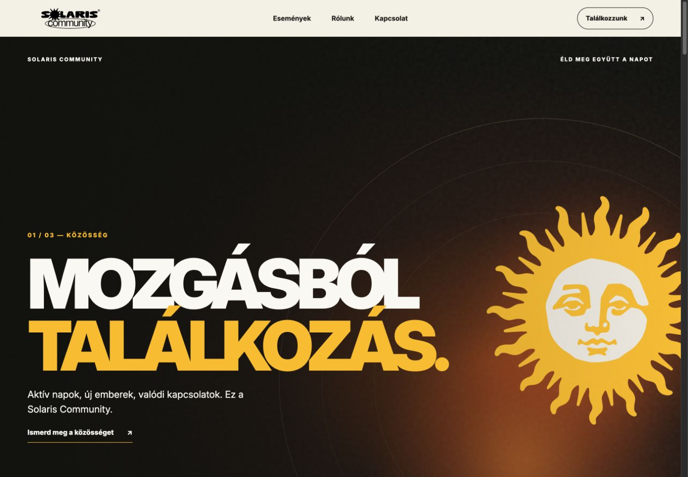
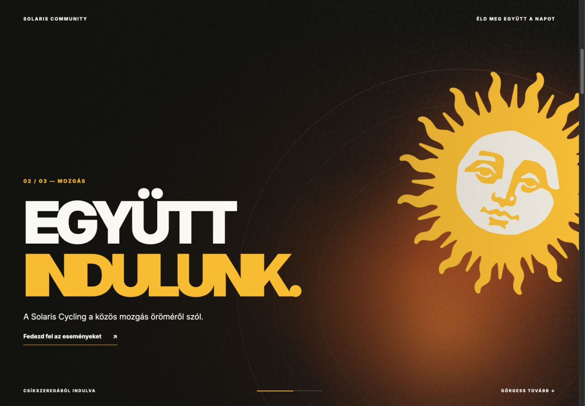
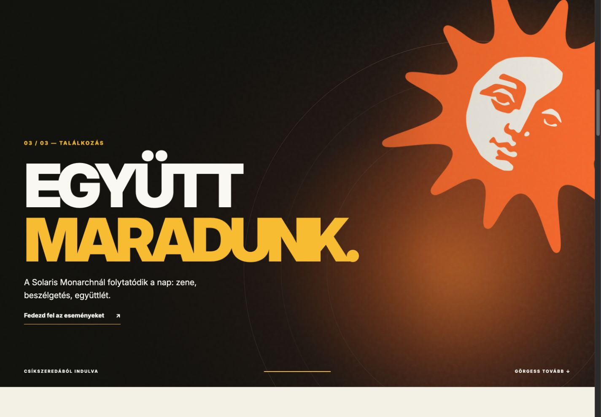
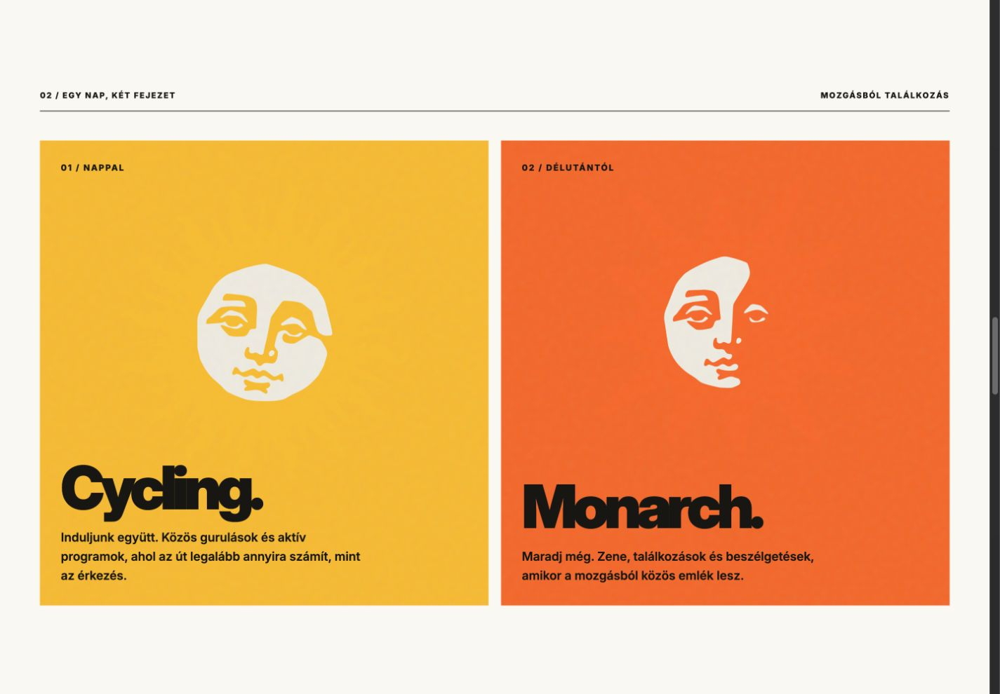
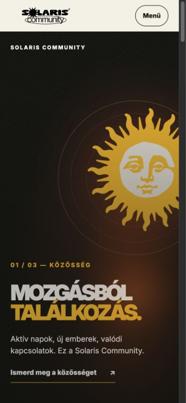

# Solaris Community

**Move together. Stay together.**

A community website that turns an active day into shared stories. Built around Solaris Cycling and Solaris Monarch, starting in Csíkszereda, Romania.



## One day. Three chapters.

Community → Cycling → Monarch. A scroll-led opening moves from belonging to shared movement, then music and conversation. Warm light, sun symbols and bold type carry the Solaris identity across desktop and mobile.

<table>
  <tr>
    <td width="50%"></td>
    <td width="50%"></td>
  </tr>
</table>

## Built to keep moving

- Event pages, photo galleries, partner content and a single organizer workspace.
- Email-only attendance intent, duplicate prevention, CSV exports and partner inquiries.
- Responsive layouts, reduced-motion support and self-hosted Inter.
- React · TypeScript · Vinext · Cloudflare D1 / R2 · Brevo.

<table>
  <tr>
    <td width="75%"></td>
    <td width="25%"></td>
  </tr>
</table>

**Status:** private preview. Organizer email access, production email delivery, final content/privacy approval and a daily retention scheduler remain launch requirements. [Current status →](docs/status.md)

[Private preview](https://solaris-community.karthuss.chatgpt.site/) · [Showcase](docs/showcase/) · [Architecture](docs/architecture.md) · [Local setup](docs/development.md) · [Project brief — HU](docs/brief.hu.md)

## Run locally

Node.js 22.13+ is required.

```sh
npm ci
npm run dev
```

The interface renders before local data is configured. See [local setup](docs/development.md) for database migrations and environment values.

## Credits

Implementation and website showcase by [Csanad Lorincz](https://github.com/karthuscode). Solaris Community supplies the brand identity. Inter is distributed under the [SIL Open Font License](public/fonts/OFL.txt); bundled third-party notices remain in the repository.

This repository documents the project for portfolio review. Solaris names, logos and supplied brand artwork remain subject to their owners’ rights. No license to reuse those assets is granted here.
