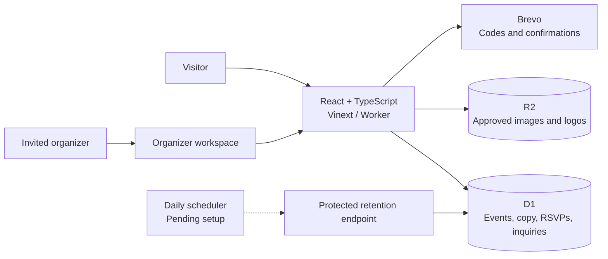

# Architecture

Solaris combines a Hungarian community website with a single organizer workspace. The home page follows one day through Community, Cycling and Monarch; the inner pages prioritize reading and practical event information.

## Content

`app/` contains pages and server endpoints. `lib/content.ts` holds the initial Hungarian copy and first-event draft; `lib/data.ts` reads D1 with a private-preview fallback. `db/schema.ts` and `drizzle/` define the durable records and migrations.

Events have draft/published status, an optional date and an RSVP switch. Media, partner records, video links and quotes have approval flags. Public image endpoints serve approved assets. Copy and translation records include a locale so a second language can be introduced later; the current UI is Hungarian only.

## Attendance intent

An event accepts an email-only RSVP when it is published, dated in the future and explicitly open. A unique event/email index prevents multiple records for the same participant. The interface and confirmation describe attendance intent for the whole day. The endpoint tracks confirmation delivery status so email failures remain visible to organizers.

## Organizer access

One-time email codes are limited to configured organizer addresses. Code hashes and attempts live in D1. Signed, expiring cookies authorize server-side admin operations. Contact and attendance submissions use validation, a honeypot, origin checks and rate limits; uploads and CSV exports are organizer-only.

## Retention and launch

Expired RSVP records are purged during relevant reads and writes. A bearer-protected maintenance endpoint provides the same purge for a daily scheduler. That independent scheduler still needs to be configured to guarantee deletion without site traffic.

The Site remains private with `PUBLIC_LAUNCH_READY=0`. Public access, content approval and production configuration are separate launch steps; [status.md](status.md) records them.
