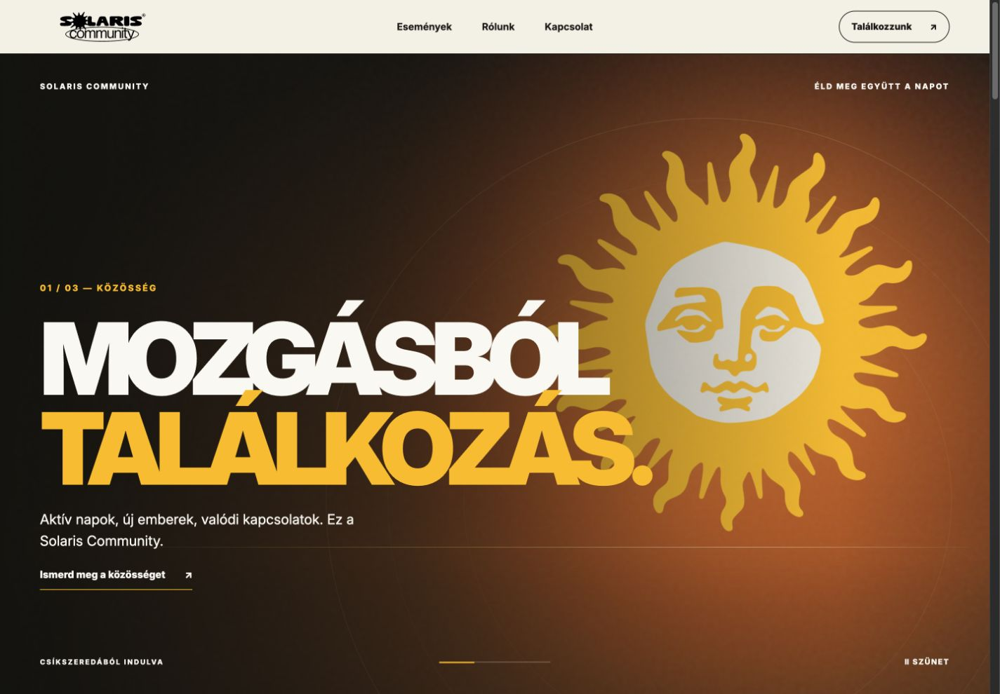
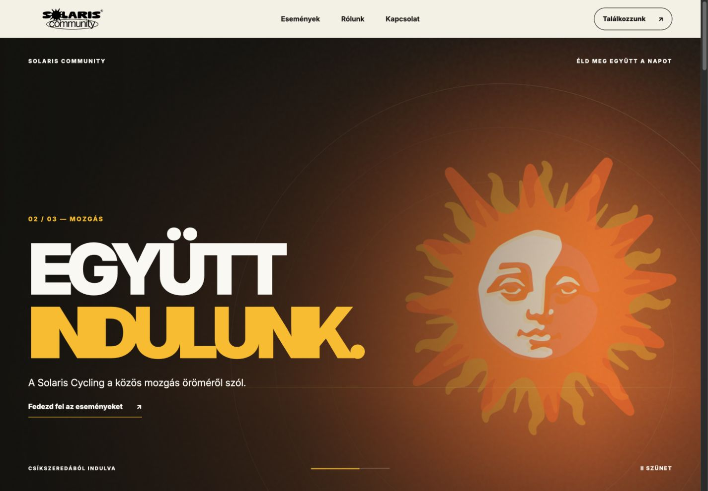
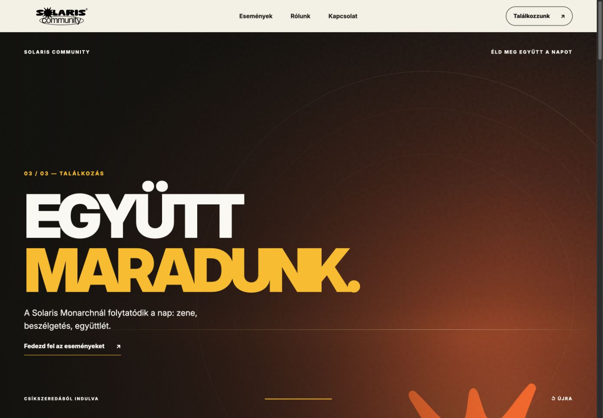
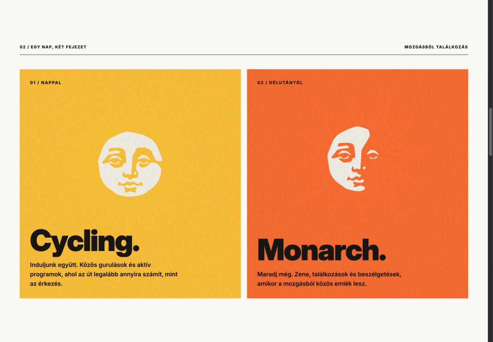
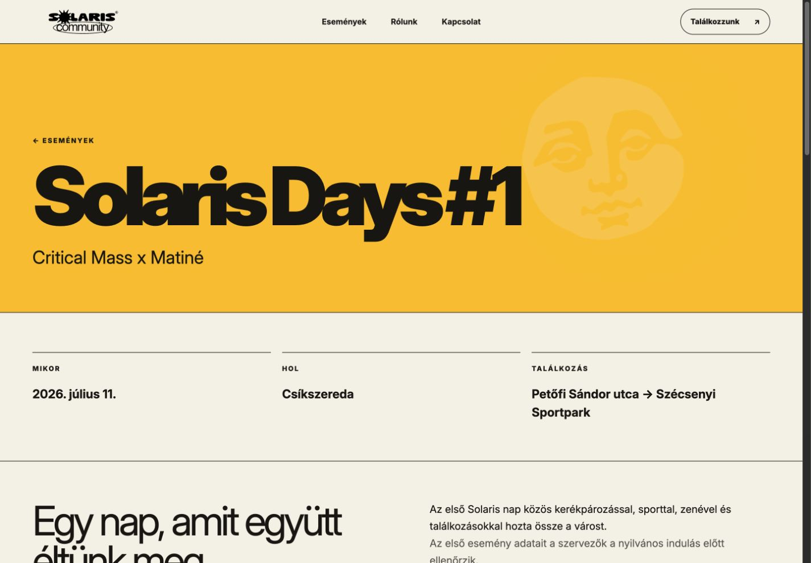
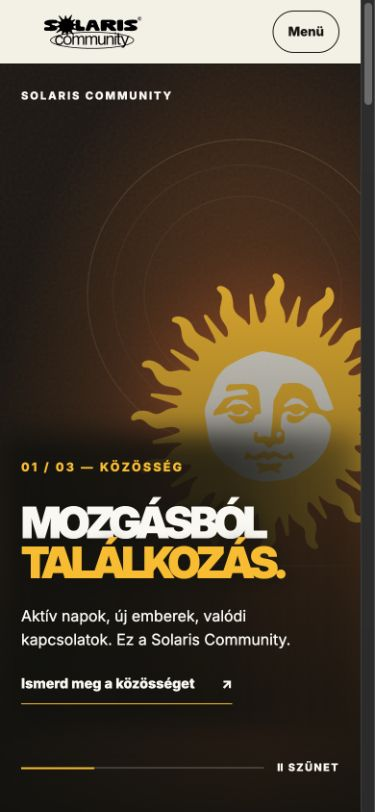

# Interface showcase

Captured from the implemented local preview on 30 September 2026. The website language is Hungarian. All images are genuine interface captures; no participant photography or testimonials were invented.

| Capture | Image size | View |
| --- | --- | --- |
| `desktop-community.jpg` | 1425 × 990 | Timed sunrise, Community chapter |
| `desktop-cycling.jpg` | 1425 × 990 | Cycling chapter and sunset transition |
| `desktop-monarch.jpg` | 1425 × 990 | Final Monarch chapter |
| `desktop-chapters.jpg` | 1425 × 990 | Daytime and evening cards |
| `mobile-community.jpg` | 375 × 812 | Mobile sunrise |
| `desktop-event.jpg` | 1425 × 990 | First-event draft |

These screenshots show the refreshed local version. The hosted private preview still shows the earlier milestone. Event data, media and partner credits are still awaiting organizer approval; see [project status](../status.md).

## Community

## Cycling and Monarch

## Two parts of the day

## First-event draft

## Mobile

